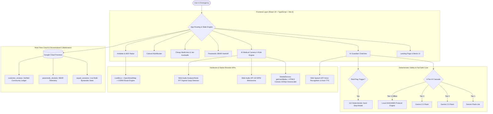
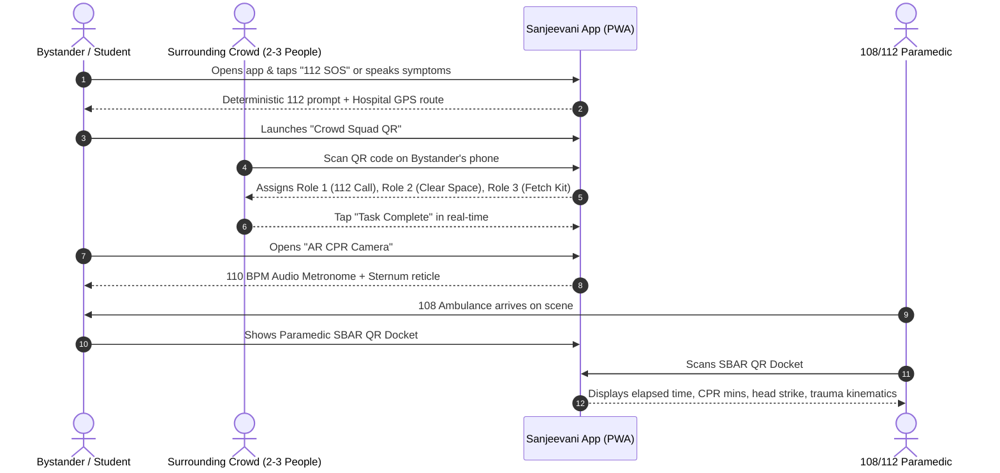
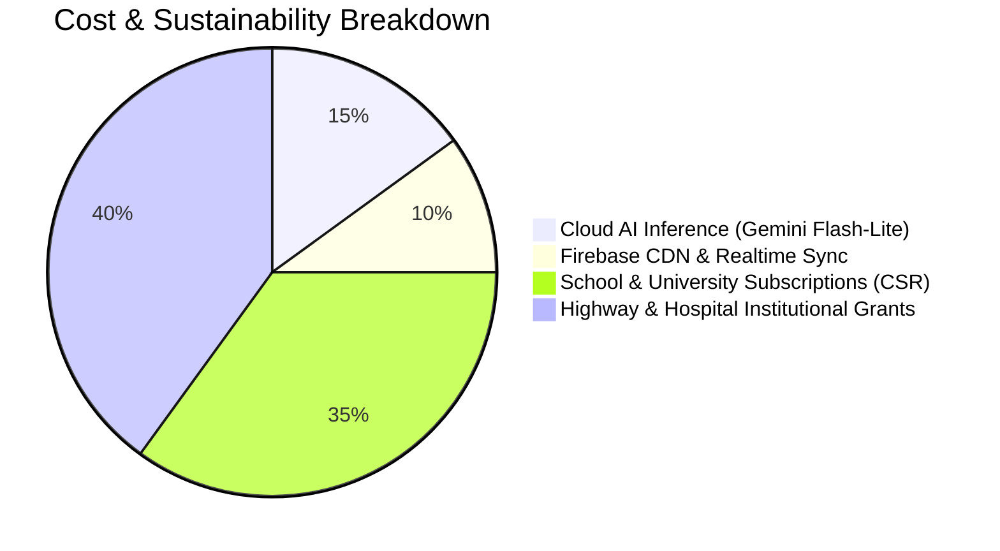

# Sanjeevani v2.0: The Complete Master Writeup & Technical Whitepaper

> **Sanjeevani First-Aid Intelligence (v2.0)**  
> *Transforming Every Smartphone into an Offline-Resilient Pre-Hospital Trauma Command Center.*  
> **Live Web Application:** [https://sanjeevani-v2.web.app](https://sanjeevani-v2.web.app)  
> **Repository Base:** `C:\Users\drsha\.gemini\antigravity\scratch\sanjeevani-v2`  
> **Founders:** Dakshita Kapoor & Samyak Verma (Seth M.R. Jaipuria School)  
> **Key Contributor:** Siddhi Misra  

---

## 1. Executive Summary & Genesis

### 1.1 The Genesis Story
Sanjeevani was conceived at **Seth M.R. Jaipuria School (Lucknow, India)** following the school’s recognition among the **World’s Top 10 Schools by T4 Education** for Community Collaboration. Founders **Dakshita Kapoor** and **Samyak Verma**, alongside student researcher **Siddhi Misra**, realized that while civic responsibility was taught in classrooms, there was a fatal breakdown in real-world emergencies: **when accidents happen on Indian streets or in schools, 20 bystanders freeze in panic, film videos, or administer harmful home remedies while waiting 20 to 45 minutes for an ambulance.**

### 1.2 The Core Mission
In India, more than **150,000 people die annually in road traffic accidents**, and over **58,000 die from snakebites**—many during the critical **"Golden Hour"** before reaching an Emergency Room. Furthermore, out-of-pocket expenditure on branded prescription drugs pushes millions of families into poverty each year.

Sanjeevani v2.0 bridges this gap by turning every smartphone into a **decentralized, offline-resilient Trauma Command Center** that:
1. Coordinates surrounding bystanders into a structured 3-person rescue team in under 10 seconds via **Crowd Squad QR**.
2. Synthesizes hardware-timed **110 BPM CPR coaching** and **AR chest guidance** directly in the browser.
3. Automatically generates an offline-scannable **SBAR Clinical Telemetry Docket** for incoming 108/112 paramedics.
4. Pinpoints India-specific life infrastructure (Metro AEDs, Civil Hospital Anti-Snake Venom, 24/7 Burn Care).
5. Debunks dangerous cultural home myths with AIIMS/WHO evidence.
6. Maps expensive branded prescriptions to identical-salt **PMBJP Jan Aushadhi Kendra** generic medicines saving up to **85%**.

---

## 2. Core Architectural Philosophy: Why Sanjeevani vs. ChatGPT / Gemini

General-purpose Large Language Models (LLMs) like ChatGPT or Google Gemini are designed for **conversational deliberation**, whereas a medical emergency requires **immediate clinical execution**.

| Dimension | Generic LLMs (ChatGPT / Gemini) | Sanjeevani v2.0 Trauma Platform |
| :--- | :--- | :--- |
| **Response Style** | 400-word conversational paragraphs | Numbered 1-2-3 actionable imperatives + bold contraindications |
| **Safety Override** | Generates text even for cardiac arrest | **Deterministic 112 Hard-Stop Modal** with live ICU driving map |
| **Bystander Coordination** | 1 user on 1 phone | **Crowd Squad QR** (multi-phone task delegation with zero login) |
| **Paramedic Handover** | Unstructured chat history | Structured **SBAR QR Docket** + live trauma stopwatch |
| **Physical Tools** | None | **110 BPM Audio Metronome**, **AR Sternum Guide**, **Acoustic Gasp Detector** |
| **India Infrastructure** | Generic web links | Live coordinates of **ASV (Anti-Venom)**, **ARV**, Metro AEDs, Jan Aushadhi |
| **Offline Resilience** | 100% dead when network drops | **Tier-4 Local Deterministic Clinical Engine** (`<50 ms`) |

---

## 3. Complete Technical Architecture & Technology Stack

Sanjeevani is engineered as a **zero-install, ultra-low-latency Progressive Web Application (PWA)** deployed on **Firebase Hosting Global CDN**.

### 3.1 Frontend Stack
- **Framework:** React 19 with TypeScript, bundled with Vite 8.
- **Styling:** Tailwind CSS with a clinical semantic token system (`bg-base`, `bg-surface`, `text-ink`, `border-border`, `bg-primary`, `bg-alert`).
- **Icons:** Lucide React.
- **Maps:** Leaflet 1.9 with OpenStreetMap Nominatim reverse-geocoding.
- **Motion & Scroll Engine:** Hardware-accelerated `IntersectionObserver` with GPU-composited transforms (`translate3d(0, 28px, 0)`).

### 3.2 Multimodal AI & 4-Tier Fail-Safe Cascade ([`aiService.ts`](file:///C:/Users/drsha/.gemini/antigravity/scratch/sanjeevani-v2/src/services/aiService.ts))
1. **Tier 1 (`gemini-flash-lite-latest`):** Ultra-fast lightweight model achieving `<2s` inference.
2. **Tier 2 (`gemini-2.5-flash`):** Automatic failover on network timeouts or rate limits.
3. **Tier 3 (`gemini-2.0-flash`):** High-reliability cloud fallback.
4. **Tier 4 (Offline Clinical Fallback Engine):** If network drops completely, regex clinical matching serves verified AHA 2020 / AIIMS protocols locally in `<50 ms`.

### 3.3 Backend & Security Architecture ([`firestore.rules`](file:///C:/Users/drsha/.gemini/antigravity/scratch/sanjeevani-v2/firestore.rules))
- **Authentication:** Firebase Auth (Email/Password, Google OAuth, and Anonymous Guest access).
- **Database:** Google Cloud Firestore with real-time `onSnapshot` subscriptions.
- **Zero-Friction Access:** Unauthenticated bystanders and paramedics can read and update live task statuses (`squad_sessions` and `paramedic_dockets`) with zero login friction, while public feedback (`customer_reviews`) enforces strict character limits and ownership rules.

---

## 4. Deep Dive: Every Feature, Clinical Tool & Module

### 4.1 112 SOS Deterministic Hard-Stop Override & Live Route Map ([`EscalationModal.tsx`](file:///C:/Users/drsha/.gemini/antigravity/scratch/sanjeevani-v2/src/components/common/EscalationModal.tsx))
- **Trigger:** Tapping the header `112 SOS` button or entering life-threatening keywords (unconscious, arterial spurting, severe anaphylaxis).
- **Behavior:** Immediately pauses regular conversational guidance. Renders a high-contrast `#D93A3A` Alert Banner.
- **Live Dispatch Map:** Calculates driving distance and ETA to the nearest Level-1 trauma facility via [`placesRoutesService.ts`](file:///C:/Users/drsha/.gemini/antigravity/scratch/sanjeevani-v2/src/services/placesRoutesService.ts), rendering an interactive Leaflet route map with turn-by-turn steps.
- **Escape & Drill Controls:** Constrained to `max-h-[92vh] flex flex-col` with a scrollable middle body so the pinned top-right **✕ Exit** button and bottom **Cancel & Exit 112 SOS** button remain visible on every screen.

### 4.2 Crowd Squad QR: Multi-Bystander Delegation Engine ([`CrowdCommanderModal.tsx`](file:///C:/Users/drsha/.gemini/antigravity/scratch/sanjeevani-v2/src/components/crowd/CrowdCommanderModal.tsx) & [`SquadJoinView.tsx`](file:///C:/Users/drsha/.gemini/antigravity/scratch/sanjeevani-v2/src/components/crowd/SquadJoinView.tsx))
- **The Problem:** The "Bystander Effect" causes crowds to freeze or film videos.
- **The Solution:** The lead responder displays a full-screen dynamic QR code. When surrounding bystanders scan it with their camera:
  - **Role 1 (112 Dispatch & GPS Beacon):** Calls 112 with exact rooftop coordinates and prominent landmarks.
  - **Role 2 (Crowd Control & Airway Protection):** Moves spectators back 10 feet for ventilation and prevents anyone from giving water to drowsy patients.
  - **Role 3 (AED & Tourniquet Runner):** Sprints to retrieve the nearest defibrillator, first-aid kit, or clean cloth.
- **Real-Time Synchronization:** As bystanders tap **"Claim Role"** and **"Mark Task Complete"**, the commander’s screen updates live via Cloud Firestore.

### 4.3 Paramedic SBAR Handover Docket ([`ParamedicHandoffView.tsx`](file:///C:/Users/drsha/.gemini/antigravity/scratch/sanjeevani-v2/src/components/handoff/ParamedicHandoffView.tsx) & [`DocketMarkdownView.tsx`](file:///C:/Users/drsha/.gemini/antigravity/scratch/sanjeevani-v2/src/components/handoff/DocketMarkdownView.tsx))
- **Clinical Telemetry Captured:**
  - Live **Trauma Stopwatch** (running incident clock).
  - Unresponsive duration (seconds).
  - Head-strike verification and exact anatomical location.
  - Seizure duration & `NPO` status (verifying no oral fluids were given).
  - Cumulative CPR minutes & direct pressure minutes.
  - Mechanism of Injury (MOI) and chronological event timeline.
- **Handover Modalities:**
  - **Offline QR Code:** Encodes the entire clinical payload inside the QR SVG itself.
  - **15-Second Verbal SBAR Script:** Auto-generated script for bystanders to read aloud.
  - **Export Options:** 1-tap Download `.md` file and browser-native Print Clinical Sheet.

### 4.4 AI Medical Camera: 4 Specialized Clinical Roles ([`AIMedicalCameraView.tsx`](file:///C:/Users/drsha/.gemini/antigravity/scratch/sanjeevani-v2/src/components/camera/AIMedicalCameraView.tsx))
- **Role 1: Visual Injury Triage:** Analyzes burns, lacerations, bites, or fractures via Gemini Vision with client-side downscaling. Outputs severity badge, visual findings, immediate steps, and strict contraindications.
- **Role 2: AR CPR Chest Guide:** Overlays an interactive sternum reticle over the patient’s chest (with a Demo Patient simulation mode) coupled with a **110 BPM Web-Audio Synthesizer** ensuring `2 inches / 5 cm` compression depth.
- **Role 3: Prescription OCR & Generic Matcher:** Reads doctor prescriptions, extracts brand names and dosages, and matches them to PMBJP Jan Aushadhi generic salts.
- **Role 4: In-App Sanjeevani QR Scanner:** High-speed canvas QR decoder that opens Squad Join views or Paramedic Dockets directly inside the camera view.

### 4.5 AI Video Forensic Analyzer ([`VideoForensicAnalyzer.tsx`](file:///C:/Users/drsha/.gemini/antigravity/scratch/sanjeevani-v2/src/components/video/VideoForensicAnalyzer.tsx))
- Extracts key chronological video frames in the browser using an offscreen canvas.
- Multimodal Gemini Vision reconstructs the **Mechanism of Injury (MOI)**, deceleration kinematics, blunt vs. penetrating vectors, and occult cervical spine risks for ER trauma doctors.

### 4.6 Cheap Medicines & PMBJP Jan Aushadhi Kendra Matcher ([`CheapMedicinesView.tsx`](file:///C:/Users/drsha/.gemini/antigravity/scratch/sanjeevani-v2/src/components/medicines/CheapMedicinesView.tsx))
- Search database of Indian pharmaceuticals by brand name, salt, or disease category.
- Displays identical active chemical salts, strength, dosage form, and WHO/NLEM essential status.
- Real-time price comparison showing PMBJP Jan Aushadhi savings (often **50% to 85% cheaper**) alongside private pharmacies (1mg, PharmEasy, Netmeds, Apollo).

### 4.7 Hyper-Local Antidote & AED Radar ([`EmergencyRadarModal.tsx`](file:///C:/Users/drsha/.gemini/antigravity/scratch/sanjeevani-v2/src/components/radar/EmergencyRadarModal.tsx))
- Categorized live infrastructure radar:
  - `⚡ Metro & Transit AEDs` (public automated external defibrillators).
  - `🐍 Anti-Venom & Rabies (Cold-Chain ASV / ARV)` in Civil/Government hospitals.
  - `💊 24/7 Pharmacies & Sterile Burn Supplies`.
  - `🏥 Level-1 Trauma Centers & ICUs`.
- Includes live driving route calculation, ETA, and direct desk phone dialers.

### 4.8 Cultural MythBuster ([`MythBusterView.tsx`](file:///C:/Users/drsha/.gemini/antigravity/scratch/sanjeevani-v2/src/components/mythbuster/MythBusterView.tsx))
- Clinically debunks widespread, fatal Indian home remedies:
  - *Myth:* Toothpaste or butter on burns $\rightarrow$ *Clinical Reality:* Traps heat, causes deep dermal infection; use running tap water for 20 minutes.
  - *Myth:* Tying tight cloth tourniquets or sucking snakebites $\rightarrow$ *Clinical Reality:* Causes ischemic gangrene and amputation; use broad pressure immobilization and keep limb below heart.
  - *Myth:* Putting metal keys in a seizure patient's hands $\rightarrow$ *Clinical Reality:* Risk of oral laceration; turn patient onto recovery side and protect head.
- Includes an AI-powered custom myth verifier for regional folklore remedies.

### 4.9 Acoustic Agonal Gasp Detector ([`AcousticGaspDetector.tsx`](file:///C:/Users/drsha/.gemini/antigravity/scratch/sanjeevani-v2/src/components/diagnostics/AcousticGaspDetector.tsx))
- Uses Web Audio API `AnalyserNode` to analyze 10 seconds of breathing audio via microphone.
- Distinguishes between rhythmic physiological respiration and irregular agonal gasping (brainstem reflex present in 40% of cardiac arrests), prompting immediate CPR initiation.

### 4.10 Verified Offline Protocol Library ([`LibraryView.tsx`](file:///C:/Users/drsha/.gemini/antigravity/scratch/sanjeevani-v2/src/components/library/LibraryView.tsx))
- Standalone, zero-latency clinical protocols for:
  - Unconscious Adult/Child CPR
  - Severe Arterial Bleeding & Hemorrhage
  - Choking (Heimlich & Back Blows)
  - Thermal, Chemical & Electrical Burns
  - Fractures & Splinting
  - Snakebite & Scorpion Stings
  - Heatstroke & Environmental Hyperthermia
  - Pediatric Febrile Seizures

### 4.11 Interactive CPR & First-Aid Practice Drills ([`PracticeView.tsx`](file:///C:/Users/drsha/.gemini/antigravity/scratch/sanjeevani-v2/src/components/practice/PracticeView.tsx))
- Gamified classroom simulations with timed decision scenarios and rhythm audio tests to build muscle memory before a crisis.

### 4.12 Doorstep & Rooftop Precision Location Engine ([`LocationPickerModal.tsx`](file:///C:/Users/drsha/.gemini/antigravity/scratch/sanjeevani-v2/src/components/common/LocationPickerModal.tsx))
- Combines hardware GPS with a draggable Leaflet rooftop pin, OpenStreetMap reverse geocoding, specific flat/house number inputs, and 1-tap Indian city capital hubs.

### 4.13 Live Community Reviews Ledger ([`CommunityReviewsSection.tsx`](file:///C:/Users/drsha/.gemini/antigravity/scratch/sanjeevani-v2/src/components/landing/CommunityReviewsSection.tsx))
- Real-time Cloud Firestore customer review ledger. Displays 100% full unabridged reviews in a clean tabular format on desktop and vertical card rows on mobile—featuring testimonials from founders (**Dakshita Kapoor**, **Samyak Verma**), testers (**Siddhi Misra**), doctors, and students.

---

## 5. Timeline: The First 180 Seconds of an Incident

---

## 6. Clinical Validation & Legal Framework

### 6.1 Clinical Validation Standards
All protocols and logic in Sanjeevani are benchmarked against:
1. **American Heart Association (AHA 2020 Guidelines):** CPR cadence (`100–120 BPM`), compression depth (`2 inches / 5 cm`), complete chest recoil, and early defibrillation.
2. **AIIMS (All India Institute of Medical Sciences) Emergency Protocols:** National snakebite pressure immobilization, rabies wound irrigation, and extreme heatstroke active cooling.
3. **WHO & NLEM (National List of Essential Medicines):** Active chemical salt equivalence and pediatric burn irrigation standards.

### 6.2 Protection under India's Good Samaritan Law
Bystanders often fear helping accident victims due to police harassment or legal liability. Sanjeevani operates within the protections of the **Good Samaritan Law** enacted by the **Supreme Court of India** (*SaveLIFE Foundation vs. Union of India, 2016*) and codified in **Section 134A of the Motor Vehicles Amendment Act, 2019**:
- Bystanders who help an injured person cannot be subjected to civil or criminal liability.
- Bystanders cannot be compelled to disclose their name or identity.
- Bystanders cannot be detained at hospitals or police stations.

---

## 7. Unit Economics & Sustainability Model

An emergency tool must **never** be gated behind ads or paywalls during a crisis.

- **Inference Cost per Session:** Due to client-side downscaling and lightweight model selection, average cloud inference costs are **less than ₹0.04 ($0.0005) per session**.
- **Institutional Deployment:** Funded via school safety subscriptions, CSR health grants, and state disaster management partnerships, keeping the platform **100% free and ad-free** for citizens.

---

## 8. Future Roadmap (Sanjeevani v3.0)

1. **Multilingual Voice Triage in 12 Indian Languages:** Full offline voice input/output in Hindi, Bengali, Tamil, Telugu, Marathi, Gujarati, Kannada, Malayalam, and Punjabi for rural ASHA workers.
2. **Direct 108/112 Computer-Aided Dispatch (CAD) Integration:** Direct webhook transmission of the SBAR docket and doorstep GPS coordinates to the incoming ambulance tablet upon 112 trigger.
3. **Smartwatch Crash Detection & Wearable Beacon:** Automatic triggering of the Crowd Squad QR beacon upon high-G impact or prolonged cessation of pulse.

---

*Authored by the Sanjeevani Engineering & Clinical Intelligence Team.*  
*Documentation verified for Sanjeevani v2.0.*
