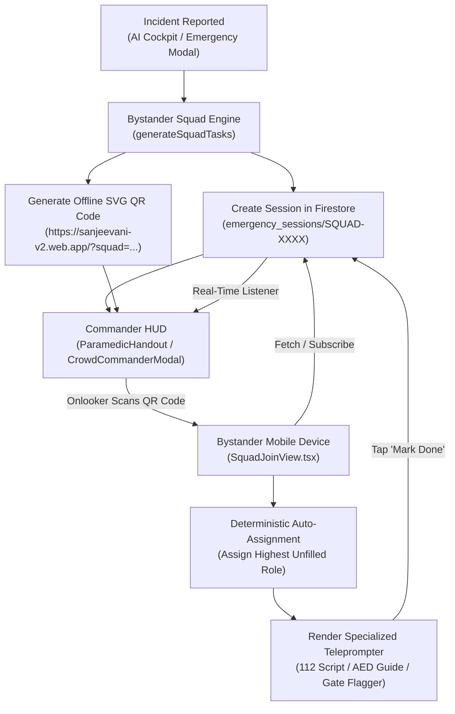

# Feature Specification: AI-Powered Bystander Paradox Resolution Engine

> **Feature Name**: Bystander Paradox Dynamic Task Allocation & Crowd QR Beacon  
> **Target Release**: Sanjeevani v2 — Emergency AI Decision Support  
> **Status**: Draft Proposal (Ready for Review)  
> **Lead Architect**: Sanjeevani Emergency Medicine & AI Systems Team  

---

## 1. 🎯 Executive Summary & The Problem

### 1.1 The Bystander Paradox (Diffusion of Responsibility)
In sudden pre-hospital trauma and cardiac emergencies, the presence of a crowd often **decreases** the likelihood that any single individual will render assistance. Known in emergency medicine and social psychology as the **Bystander Effect** (or *Genovese syndrome*):
- **Diffusion of Responsibility**: Every person in the crowd subconsciously assumes *someone else* has already dialed 112, someone else knows CPR, or someone else is retrieving the first-aid kit.
- **Evaluation Apprehension**: Bystanders fear making a mistake, contracting bloodborne pathogens, or facing legal liability.
- **Pluralistic Ignorance**: Because onlookers see others standing still or filming on smartphones, they interpret the situation as either non-critical or handled.

### 1.2 The Clinical Solution: Algorithmic Direct Delegation
The American Heart Association (AHA), European Resuscitation Council (ERC), and AIIMS Emergency Medicine protocols mandate that the first step to breaking the bystander effect is **Direct, Eye-to-Eye Delegation**:
> *"You in the yellow shirt, call 112! You with the backpack, find an AED! You, clear the road for the ambulance!"*

Sanjeevani automates and scales this clinical principle into software:
When an incident is reported, **Sanjeevani AI instantly generates a live Bystander Squad Room & high-contrast QR Code**. Onlookers point their phone cameras at the QR code (no app download required) and are **automatically assigned specific, prioritized, life-saving tasks** tailored to the incident type with interactive teleprompters and one-tap status updates.

```
       [ Emergency Incident Reported ]
                     │
         AI Triage & Crowd Assessment
                     │
    ┌────────────────┴────────────────┐
    ▼                                 ▼
[ Primary Commander ]        [ Onlookers & Bystanders ]
• Generates Squad QR Beacon   • Scan with ANY phone camera
• Audio Crowd Broadcast       • Instant Web PWA (No Login)
• Real-time Task HUD          • Auto-Assigned Specific Role
    │                                 │
    └──────────────◄──────────────────┘
            Real-Time State Sync
      (Firestore / BroadcastChannel)
```

---

## 2. ⚡ Key Product Capabilities

### 2.1 Context-Aware Dynamic AI Task Generation
Tasks are **not** static or generic. When an incident is analyzed (via text, voice, injury photo, or video incident analysis), the AI synthesizes an incident-specific role hierarchy:

| Incident Category | Top Priority Roles Assigned to Bystanders |
| :--- | :--- |
| **Cardiac Arrest / Unresponsive** | **Role 1**: 110 BPM Chest Compressions (Audio Metronome)<br/>**Role 2**: 112 Dispatch Caller (GPS Teleprompter Script)<br/>**Role 3**: AED Scout (Find automated external defibrillator in 200m)<br/>**Role 4**: Siren Flagger (Direct ambulance at main gate)<br/>**Role 5**: Crowd & Airflow Marshal (Keep crowd 15ft back) |
| **Arterial Hemorrhage / Deep Bleeding** | **Role 1**: Direct Pressure / Tourniquet Maintainer<br/>**Role 2**: 112 Trauma Dispatcher (Hemorrhage severity script)<br/>**Role 3**: First-Aid Trauma Pack & Clean Cloths Scout<br/>**Role 4**: Traffic Diverter (Safeguard scene from oncoming traffic)<br/>**Role 5**: Patient Reassurer (Treat for shock, keep warm) |
| **Road Traffic Accident (RTA)** | **Role 1**: C-Spine Immobilizer (Hold head neutral, DO NOT MOVE)<br/>**Role 2**: 112 Multi-Casualty Dispatcher<br/>**Role 3**: Hazard Isolator (Turn off vehicle ignition, hazard lights)<br/>**Role 4**: Traffic Stopper (Place warning triangles 50m back)<br/>**Role 5**: Ambulance Gate Guide |
| **Toddler / Adult Choking** | **Role 1**: Airway Clearer (5 Back Blows + 5 Abdominal Thrusts)<br/>**Role 2**: 112 Pediatric Emergency Caller<br/>**Role 3**: Elevator / Stretcher Path Cleared<br/>**Role 4**: Family / Bystander Calmer |
| **Severe Scald / Chemical Burn** | **Role 1**: Continuous Cool Running Water Overseer (20 mins)<br/>**Role 2**: 112 Burn Center Dispatcher<br/>**Role 3**: Plastic Cling Wrap & Dressing Scout<br/>**Role 4**: Chemical / Electrical Hazard Neutralizer |

---

### 2.2 Instant Zero-Install QR Onboarding for Bystanders
1. **Universal Mobile Web Access**:
   - The QR code encodes a lightweight web URL: `https://sanjeevani-v2.web.app/?squad=SQUAD-XXXXXX`.
   - Works immediately on any iPhone (Safari) or Android (Chrome, Samsung Internet).
   - **Zero app installation**, **zero login barrier**, and **zero permission prompts** required to start saving a life.
2. **Deterministic Role Assignment Algorithm**:
   - When Bystander #1 scans: System automatically assigns the **highest-priority unfilled role** (e.g., *112 Emergency Dispatcher*).
   - When Bystander #2 scans: System assigns the **next unfilled role** (e.g., *AED Scout*).
   - When Bystander #3 scans: System assigns *Ambulance Siren Flagger*.
   - Bystanders can optionally switch roles if someone has medical certification or specific equipment.
3. **Interactive Role Teleprompter UI**:
   - **112 Caller**: Displays a prominent **"Call 112"** button with a pre-written, word-for-word script including the patient's exact doorstep GPS address and symptoms.
   - **AED Scout**: Displays visual guidance on where AEDs are legally stationed (Metro security, malls, gym receptions) and how to carry one.
   - **Airflow / Crowd Guard**: Displays audio-prompted crowd clearance scripts (*"Step back 15 feet! Give the victim oxygen!"*).
   - **Status Buttons**: One-tap **"I'm On It"** and **"Task Completed ✅"** buttons that immediately notify the entire squad.

---

### 2.3 Audio Crowd Marshalling Beacon
The primary incident commander's phone can tap **"📢 Broadcast Crowd Announcement"**:
- Uses the device speaker (Web Audio & Speech Synthesis) at maximum volume to issue an authoritative command:
  > *"Attention everyone nearby! We have an emergency medical incident. Please look at this screen, scan the QR code with your camera, and take your assigned task now."*
- Breaks bystander paralysis through clear auditory authority.

---

### 2.4 Real-Time Bidirectional Telemetry (Commander HUD)
The primary commander’s AI Cockpit displays a live **Bystander Squad Matrix**:
- 🟢 **Bystander 1 (Rahul)**: Calling 112 — `[ IN PROGRESS ]`
- 🟢 **Bystander 2 (Sneha)**: AED Search — `[ ITEM SECURED ✅ ]`
- 🟡 **Bystander 3**: Gate Flagger — `[ CLAIMED ]`
- ⚪ **Role 4**: Crowd Airflow Guard — `[ SCAN TO CLAIM ]`

As bystanders complete tasks, the commander receives immediate visual and audio chimes (*"AED Secured by Bystander 2"*).

---

### 2.5 Offline & Resilient Dual-Mode Architecture
- **Online Mode**: Real-time Firebase Firestore synchronization (`emergency_sessions/{sessionId}`).
- **Local / Degraded Network Mode**: If cellular data drops at an underground subway station or highway, uses:
  - `BroadcastChannel` & LocalStorage for multi-tab / local devices.
  - Offline deterministic task QR encoding: The QR code itself contains the full task roster encoded directly in its payload, so any offline phone can parse the tasks without requiring an active internet connection.

---

## 3. 🏗️ Architecture & Component Design



### 3.1 Data Schema (`src/types/squad.ts` & `src/firebase/db.ts`)

```typescript
export type SquadRoleCategory = 'medical' | 'dispatch' | 'equipment' | 'perimeter' | 'logistics';
export type SquadRoleStatus = 'unassigned' | 'claimed' | 'in_progress' | 'completed';

export interface SquadTaskRole {
  id: string;                         // e.g. 'caller', 'scout', 'compressor', 'flagger', 'guard'
  title: string;                      // e.g. '112 Emergency Dispatcher'
  subtitle: string;                   // e.g. 'Read GPS Teleprompter Script'
  priority: number;                   // 1 (highest) to 6
  category: SquadRoleCategory;
  assignedTo?: string;                // e.g. 'Bystander #1 (Rahul)'
  assignedAt?: string;
  status: SquadRoleStatus;
  instruction: string;                // Step-by-step guidance
  scriptText?: string;                // Verbatim script to read
  actionType: 'call_112' | 'metronome_cpr' | 'search_aed' | 'crowd_control' | 'gate_flag' | 'checklist';
  actionPayload?: Record<string, any>;
  completedAt?: string;
}

export interface EmergencySquadSession {
  id: string;                         // e.g. 'SQUAD-849201'
  leaderId: string;
  leaderName: string;
  protocolId: string;                 // e.g. 'unconscious', 'bleeding', 'burns'
  protocolTitle: string;
  incidentSummary: string;
  urgencyLevel: 'CRITICAL_112' | 'URGENT' | 'MONITOR';
  locationAddress: string;
  nearestHospital?: {
    name: string;
    distance: string;
    eta: string;
    phone: string;
  };
  roles: Record<string, SquadTaskRole>;
  bystanderCount: number;
  status: 'active' | 'resolved';
  createdAt: string;
  updatedAt: string;
}
```

---

## 4. 📱 User Experience & Interaction Design

### 4.1 Primary Commander (AI Cockpit `ChatView.tsx`)
1. **Triggering the Feature**:
   - **Automatic Detection**: When the user mentions a crowd (e.g., *"there are 5 people standing around"* or *"crowd gathered around accident"*), or in any emergency response, the AI Guardian attaches an interactive **Bystander Squad QR Beacon Card** directly below the clinical guidance.
   - **Header Quick-Action**: A top-bar button labeled **`👥 Crowd Squad QR`** opens the full-screen Squad Hub at any time.
2. **Interactive Commander Card**:
   - Displays the large scannable QR code.
   - Displays a live roster of bystanders with real-time status chips (`[ 112 CALLED ]`, `[ SEARCHING AED ]`).
   - Buttons:
     - **📢 Audio Crowd Announcement**: Plays high-volume verbal instructions to the crowd.
     - **Enlarge QR**: Maximizes QR code to full-screen brightness.
     - **Share Link**: Copies the direct URL to WhatsApp or SMS.

### 4.2 Bystander Mobile Experience (`SquadJoinView.tsx`)
1. **Zero-Friction Scan**:
   - Bystander opens default camera app and points at QR.
   - Browser launches `SquadJoinView`.
2. **Personalized Assignment**:
   - System prompts: *"You are Bystander #2. Your assigned task is: Find Nearest AED & First-Aid Kit."*
3. **Dedicated Task Card**:
   - Clean, high-contrast dark/light card with large touch targets.
   - If **112 Caller**: Big red button **[ 📞 Call 112 ]** and large bold teleprompter text:
     > *"I am reporting a cardiac arrest at 14 Connaught Place, near Gate 2. Patient is unconscious. CPR is currently in progress. Send ALS ambulance immediately."*
   - If **Scout**: Visual checklist of likely AED locations + 1-tap **[ Found Item ]** button.
   - If **Gate Flagger**: Real-time timer and instructions on waving high-visibility fabric or flashlight.
4. **Task Completion**:
   - Tapping **[ ✅ I have finished this task ]** immediately sends a confirmation to the incident commander and advances the squad's progress.

---

## 5. 🛠️ Implementation Plan & Deliverables

### Phase 1: Core Engine & Task Templates (`src/services/bystanderSquadEngine.ts`)
- Build dynamic generator `createBystanderSquadSession(incidentType, summary, location, hospital)`.
- Implement tailored task generation for 6 major trauma categories:
  - Cardiac Arrest / CPR
  - Severe Bleeding / Hemorrhage
  - Road Accident / Collision
  - Choking
  - Burns / Scalds
  - General Medical Emergency

### Phase 2: Bystander Zero-Install Mobile PWA View (`src/components/crowd/SquadJoinView.tsx`)
- Create a dedicated standalone, ultra-fast mobile landing view.
- Route detection in `App.tsx` for `?squad=SQUAD-XXXXXX` and `/squad/:id`.
- Support role claiming, role swapping, teleprompter display, 1-tap dial 112, and task completion.
- Real-time synchronization via Firestore `onSnapshot` + local fallback.

### Phase 3: AI Cockpit Integration (`src/components/chat/BystanderSquadCard.tsx` & `ChatView.tsx`)
- Create `BystanderSquadCard.tsx` embeddable in chat responses.
- Automatically synthesize a squad session on emergency prompts or when the user mentions bystanders/crowd.
- Add **`👥 Crowd Squad QR`** quick-access button in the AI Cockpit header.
- Add Web Audio verbal crowd announcement (*"Attention bystanders, scan this QR code now"*).

### Phase 4: Full Crowd Commander Hub Upgrade (`src/components/crowd/CrowdCommanderModal.tsx`)
- Upgrade the existing modal to support dynamic 4-to-6 role generation, live bystander join counter, and real-time task check-offs.

### Phase 5: Verification & Production Deployment
- Test multi-client synchronization across multiple browser sessions / mobile viewports.
- Verify 100% offline fallback when network is disconnected.
- Build production bundle (`npm run build`) and deploy live to Firebase Hosting (`sanjeevani-v2.web.app`).

---

## 6. 📋 Key Design Decisions for Review

1. **Auto-Assignment vs Self-Selection**:
   - **Recommended Approach**: Auto-assign immediately upon scan to eliminate cognitive freeze and decision paralysis. Provide an intuitive "Swap Task" button if someone has CPR training or already has an AED.
2. **Audio Marshalling Language**:
   - Supports clear authoritative English and Hindi synthesis to effectively command attention in Indian metro and suburban environments.
